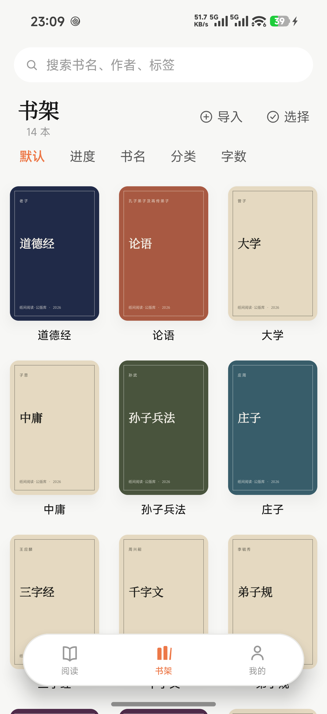
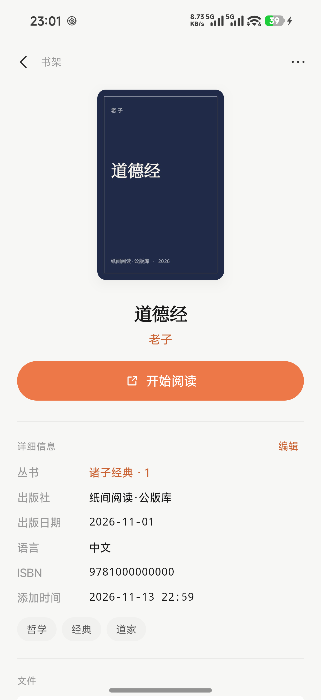
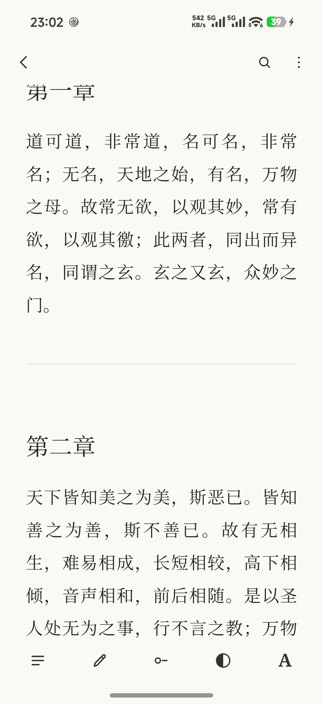
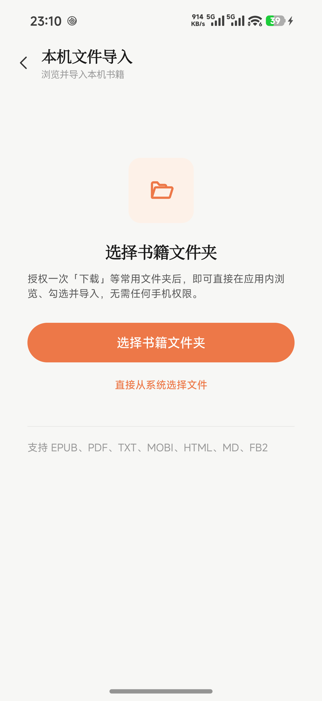
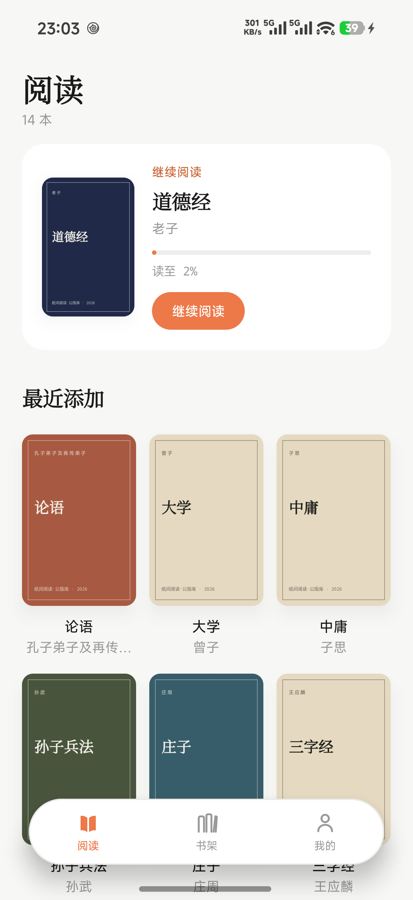
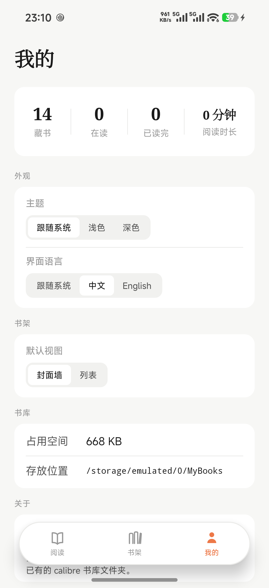
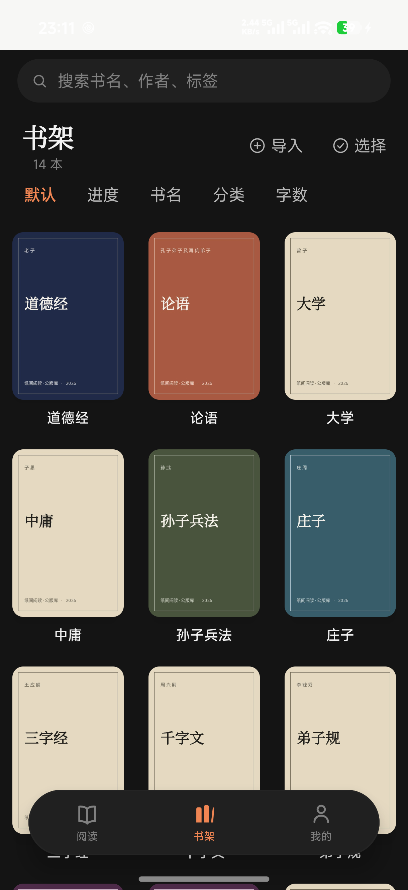

<p align="center"></p>

# 纸间阅读 · Paperlight

> Reading between the pages.

一款安静、快速的安卓电子书阅读器。读写 **calibre 书库**（`metadata.db`），开箱即带一柜完整公版中文典籍，支持**扫描文件夹**、**本机导入**与**链接导入**。

A calm, fast Android e-book reader that reads and writes **calibre libraries**, ships with full texts of Chinese public-domain classics, and imports books by scanning a folder, from the device, or from a link.

| 书架 | 详情 | 阅读 |
| --- | --- | --- |
|  |  |  |

| 本机导入 | 阅读页 | 我的 |
| --- | --- | --- |
|  |  |  |

| 深色主题 |
| --- |
|  |

## 特性

- **calibre 兼容的书库**：`metadata.db` 使用 calibre 的 schema（user_version 28），一本书一个文件夹，封面为 `cover.jpg`。同一个文件夹既能在 calibre 打开，也能在本应用打开——没有私有格式，没有锁定。
- **四种取书方式**
  - **内置公版典籍**：14 部完整收录——《道德经》（81 章）、《论语》（20 篇）、《大学》《中庸》《孙子兵法》（13 篇）、《庄子》内篇、《三字经》《千字文》《弟子规》，以及《唐诗选》《宋词选》《古文观止选》《山海经选》《世说新语选》，无需联网；
  - **扫描文件夹**：手动把书放进设备的 `MyBooks` 文件夹，一键扫描入库；
  - **本机导入**：应用内文件浏览，SAF 一次授权，批量导入 EPUB、PDF、TXT、MOBI、HTML、MD、FB2（自动读取书名、作者、封面）；
  - **链接导入**：粘贴 EPUB / PDF / TXT 直链，下载即入库（自动读取书名、作者、封面）。
- **阅读器**：EPUB / PDF / TXT / MOBI / HTML / MD / FB2 渲染、全文查找、自动翻页、字号缩放、进度记忆（「阅读」页显示继续阅读）。
- **在读管理**：「正在阅读」「已读完」独立页面；已读完的书点开即从头重读，进度重新计算，并累计**阅读次数**。
- **书架整理**：默认 / 进度 / 书名（拼音序）/ 分类 / 字数五种排序；分类页按 标签 → 系列 → 作者 分级归类；删除书籍时可选是否同时删除本地文件。
- **完整元数据**：书名、作者、丛书、出版社、日期、语言、ISBN、标签、评分、简介，均可编辑；封面可更换。
- **界面语言**：默认中文，内置 English；「我的」页可切换或跟随系统。
- **深浅两套主题**：纸感浅色（默认）与暖墨深色。

## 设计

纸、墨、一点朱砂。界面语言取自 Apple Books 的节奏：大标题、大封面、圆角与留白；中文标题用宋体，正文用衬线体，界面文字用无衬线体。底部是 iOS 式**悬浮 Dock**：圆角胶囊、软阴影、悬浮于屏幕底缘之上，选中变实心朱砂图标，顺序为 **阅读 / 书架 / 我的**。导入（扫描文件夹、本机导入、链接导入）收在书架的「⊕ 导入」里，设置收在「我的」里。

## 构建

需要 **JDK 21**、**Android SDK**（compileSdk 35），仓库自带 Gradle Wrapper。

```bash
# 调试版
./gradlew assembleDebug

# 发布版（需要本地签名配置，见下文「发布签名」）
./gradlew assembleRelease
```

最低 Android 7.0（API 24），目标 API 34。技术栈：Kotlin · Jetpack Compose · Material 3 · Navigation-Compose · Coil。

### 发布签名

仓库**不包含**任何密钥。构建 release 前，在 `keystore/signing.properties`（该目录已被 gitignore）中配置：

```properties
storeFile=../keystore/your.jks
storePassword=***
keyAlias=youralias
keyPassword=***
```

未配置时 release 以未签名产物输出。

> 密钥请自行离线备份。丢失后无法再签发可覆盖升级的同签名版本。

## 数据与隐私

- 书库（`metadata.db` 与书籍文件）保存在设备本地，应用**不上传任何数据**。
- 无账号体系、无追踪、无统计 SDK。
- 「链接导入」仅在用户粘贴直链时下载该文件；「本机导入」通过系统 SAF 授权只读取用户选择的文件夹。
- 主题、语言、阅读进度等设置只存本地。

## 内置样书声明

内置的 14 部典籍（《道德经》《论语》《孙子兵法》等）均为**公有领域**（public domain）文本：《道德经》《论语》《大学》《中庸》《孙子兵法》《庄子》内篇为完整全文，《三字经》《千字文》《弟子规》为完整蒙学文本，《唐诗选》《宋词选》《古文观止选》《山海经选》《世说新语选》为精选选本。文本据中文维基文库校订并统一转简体，随应用离线提供，仅供阅读与学习。如发现任何版权方面的问题，请提 Issue，我们会尽快处理。

## 代码结构

```
app/src/main/java/com/zhijian/reading/
├── data/                  # 书库与文件
│   ├── LibraryDb.kt       # calibre metadata.db（schema v28）
│   ├── Library.kt         # 查询、导入、编辑、删除
│   ├── EpubMeta.kt        # 读 EPUB 元数据（OPF，EPUB 2/3）
│   ├── EpubWriter.kt      # 写 EPUB（样书与测试用）
│   ├── Covers.kt          # 生成排印封面
│   ├── PdfMake.kt         # 生成样书 PDF
│   ├── SampleLibrary.kt   # 内置公版中文典籍
│   └── Settings.kt        # 偏好与阅读进度
├── reader/               # 多格式解码 → 统一 BookContent
│   ├── BookContent.kt    # 内容模型 + TocItem
│   ├── PageTemplate.kt   # 共享 HTML 版式外壳（主题 CSS 变量）
│   ├── BookDecoder.kt    # 按扩展名分发
│   ├── EpubReader.kt     # EPUB
│   ├── MobiReader.kt     # MOBI/AZW(KF7)：PalmDB + MOBI/EXTH + PalmDOC 解压
│   ├── TxtReader.kt      # TXT：编码嗅探 + 章节切分
│   └── HtmlReader.kt     # HTML / MD / FB2
└── ui/
    ├── L10n.kt            # 中文 / English 文案
    ├── LibraryViewModel.kt
    ├── theme/             # 纸感设计令牌
    ├── components/        # 封面、封面墙、列表行、控件
    └── screens/           # 阅读 / 书架 / 正在阅读·已读完 / 我的 / 本机导入 / 详情 / 编辑 / 阅读器 / 浏览
```

## 已知限制

- 国内书源没有公开、合法的下载 API，取书以「内置公版中文典籍 + 链接导入 + 本机导入」为主。
- 应用内阅读支持 EPUB、PDF、TXT、MOBI、HTML、MD、FB2；AZW3（纯 KF8）等 HUFF/CDIC 压缩或加密的 MOBI 会交给系统应用打开。
- calibre 的 `title_sort`/`uuid4` 触发器依赖 calibre 自带的 SQL 函数，这里建表时不带触发器，写入时自行处理排序字段。

## 参与贡献

欢迎 Issue 与 Pull Request。

## 致谢

- [calibre](https://calibre-ebook.com/) — 书库格式的事实标准。
- 界式节奏参考 Apple Books。

## License

[MIT](LICENSE) © 2026 纸间阅读 (Paperlight) contributors
